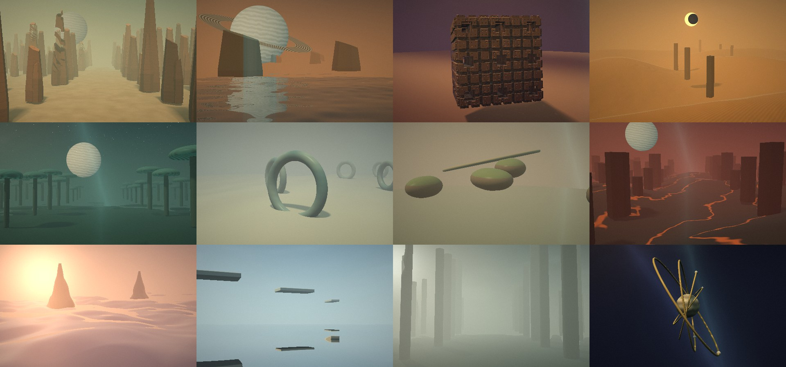

# ORBITE — cinema for curious ears

**Twelve imaginary landscapes to drift through, and a place to listen in.** A generative cinema studio that runs entirely in your browser: slow images drawn in real time, and a sound that is itself a place.



*Twelve worlds, at their first composition. Everything is computed in your browser: no images, no samples, no models, no network.*

## Start

You need **Python 3** (to serve the files locally) and a browser with **WebGL 2** and **Web Audio**: Chrome or Safari.

**On a Mac:** double-click **Run ORBITE.command**. It prints the local address and opens it in Chrome. Keep its Terminal window open while you drift; close it, or press **Ctrl+C**, to stop. See [the first-opening guide](docs/first-opening.md) if macOS asks you to confirm.

**On macOS or Linux:** `python3 scripts/serve.py`, then open the address it prints (it prefers port **4240**).

Press **Listen to the orbit**: browsers wait for a click before making sound.

## Drift

- **Twelve destinations**, and **A new elsewhere** draws a place that never existed: its name, form, sky, light and palette come from nested grammars, and the same seed always draws the same place.
- **Glide**, the default camera, is a continuous, patient drift forward. The landscape never runs out: the next crystals, islands, arches, peaks or slabs are always a little different from the last. Six other cameras (drift, forward, rising diagonal, orbit, slow zoom, panoramic crane) and a random one that blends them.
- Moving the pointer shifts your view. **Drift** sets the pace, **film grain** the texture, **resonance** how much the sound lights the image, and six tints (original, cyanotype, amber, silver, dawn, night) regrade the whole picture.
- Changing place is never a cut: the old picture dissolves into the new one.

## Listen

The sound is **Loopra Stage**: thirty-two independent loops, each repeating at its own length, in one shared key and mode. Every world brings its own key, its own space and its own selection of layers.

- **A place, not a mix.** Each layer sits at its own distance, from *at your ears* (dry, bright, a little to one side on headphones) to *on the horizon* (dark, washed in a very large reverberation). **Staging** sets how far apart they stand, **Walking** lets them drift nearer and farther over minutes, **Space** goes from a small room to a vast hall.
- **No pass is the same take.** With **Variation** up, every repetition of a loop is a little earlier or later, softer or louder, in a different position. The seed makes it reproducible.
- **The sounds are visible.** Each sounding layer glows in the landscape at its own distance: near ones large and soft, far ones small and sharp, near the horizon.
- **The harmonic pad is the foundation.** It has a level of its own, starting at 50 % so that it does not mask the other layers, and sits first in the list.
- **Silk & light starts quiet.** This sustained veil of high notes almost never stops, so it starts at 12 % of its old level; it is still an ordinary on/off layer.
- Mute any layer, draw new loop lengths, change the musical mode, enrich the harmony, or trigger a portamento call.
- Or drop your own music (MP3, WAV, M4A, OGG or FLAC, up to 256 MB) onto the studio. It loops and stays in the browser.

## Take something away

- **Save this stop** keeps the place, seed, camera, view, settings, layers and loop lengths in a notebook of up to 60 stops, which exports and imports as JSON.
- **4K image**: a 3,840 × 2,160 PNG without the interface.
- **Film 24 seconds**: a 1,920 × 1,080 film with two discreet titles and the live sound. MP4 (H.264) when the browser can, WebM otherwise. Keep the tab visible while it records.

Shortcuts: **Space** pause the image, **M** sound, **S** surprise, **F** fullscreen, **1 – 9, 0, − =** destination.

## How it is made

Plain HTML, CSS and JavaScript, no build step, no dependency. **WebGL 2** draws each landscape by ray marching, one small program per world, compiled the first time it is needed. **Web Audio** synthesizes every sound; a seeded random generator makes every room and every take reproducible.

```
dist/index.html, style.css   the studio
dist/app.js                  state, notebook, exports, the loop of frames
dist/renderer.js             the landscapes, cameras and dissolves (WebGL 2)
dist/worlds.js               the twelve worlds, their sound places, the grammars
dist/sound.js                the link to Loopra Stage
dist/loopra/                 Loopra Stage: audio.js, space.js, timbre.js, rng.js
scripts/serve.py             the small local server
```

Settings and the notebook stay in your browser's local storage, which belongs to the address you open. Export the notebook before clearing site data.

## A few limits

- WebGL 2 and graphics acceleration are required. The picture adapts its resolution to the speed it measures.
- Film export depends on the video codecs of your browser. 4K images are rendered on the spot and can take a moment.
- This is a live instrument: it does not record a performance of its sound, only the 24-second films.
- Tested in Chrome on a Mac mini M4 Pro. Safari and Firefox have not been tested.

## Who made this

Jean-Pascal — **[Quick-Eyed Sky](https://www.youtube.com/@QuickEyedSky)** on YouTube, **[QES](https://huggingface.co/QES)** on Hugging Face. Not a programmer: this exists for the pleasure of drifting through places that do not exist, with a sound that is a place too.

The sound engine is [Loopra](https://github.com/Quick-Eyed-Sky/loopra). The idea of slow loops that never realign owes a debt to Brian Eno's *Music for Airports* and *Thursday Afternoon*.

If it gives you a quiet afternoon, you can **[buy me a coffee](https://buymeacoffee.com/oFJ5CiY7n)**. Entirely optional, and ORBITE stays exactly as free either way.

## License

MIT — see [LICENSE](LICENSE). You can use, modify and share it under those terms.
